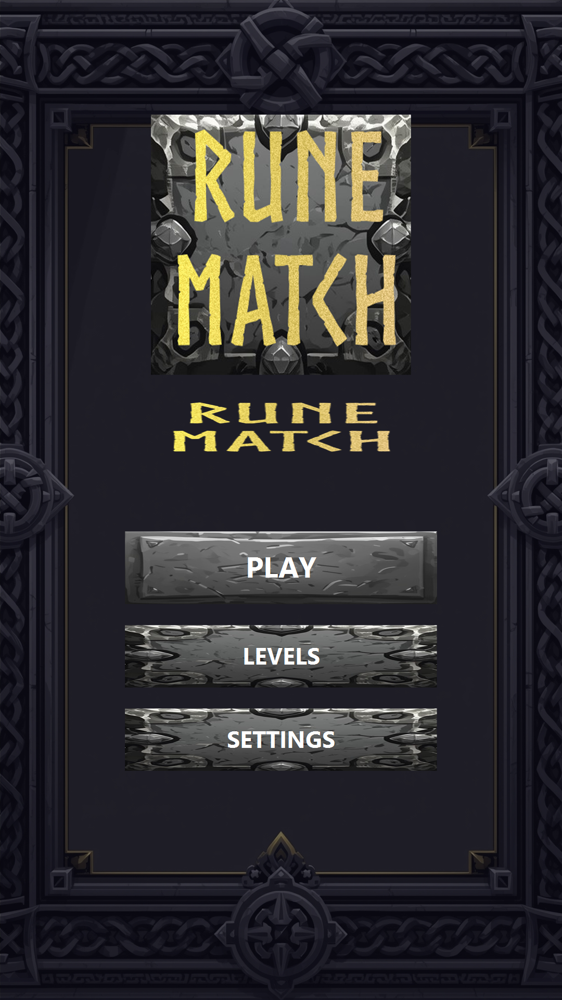
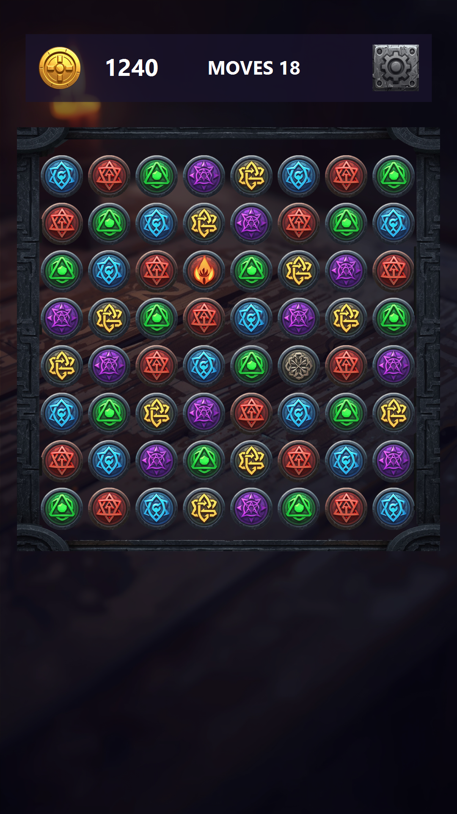

# PocketMatch

Mobile Match-3 prototype built in **Unity 6**: async board commands, VContainer service boundaries, Addressables content, and LevelPlay ad mediation. The in-game title is **Rune Match**.

[](ProjectSettings/ProjectVersion.txt)
[](LICENSE)

<p align="center">
  
  
</p>

## Highlights

- Match-3 core loop with power tiles, level objectives, and win/lose flow
- Async command-queued board resolution (swap, destroy, gravity, power tiles)
- Deadlock detection with shuffle-until-playable
- Level select and light meta progression (coins, unlocked levels)
- Coin economy: earn on win, spend to continue after fail
- VContainer scopes for bootstrap, menu, and gameplay lifetimes
- Addressables level loading and pooled VFX
- Analytics event dictionary on Unity Analytics with an opt-in consent gate, local queue, and pluggable transport
- Encrypted local save with atomic writes and Unity Cloud Save sync (anonymous sign-in, furthest-progress-wins conflict rule)
- Unity Remote Config tunables (continue cost and reward, interstitial flag, level 1 moves) with cached and baked-in offline defaults
- Unity LevelPlay banner and interstitial mediation, with a rewarded lose-continue path integrated
- Unity Localization (`en` / `es`) with Localizer CSV interchange
- Edit Mode tests for board rules, match detection, potential moves, shuffle, objective counting, ad retry, rewarded continue, economy rules, save orchestration with a fake cloud provider, save conflict resolution, save encryption, atomic file writes, tunables parsing, and localization keys
- CI: Edit Mode tests on pushes to master and on pull requests that touch project files; Android build on master

## Architecture

```text
BootstrapLifetimeScope (DontDestroyOnLoad)
  Save / Economy / Analytics / Ads / Audio / Localization / Backend
        |
        v
Loader -> MainMenu (MenuLifetimeScope)
        |
        v
Loader (optional interstitial gate) -> PlayScene (GameLifetimeScope)
```

Board mutations serialize through `CommandInvoker` and `ICommand` implementations. Live-service hooks enter at level events (start/complete/fail) and Loader transitions (interstitials).

Details: [docs/architecture.md](docs/architecture.md)

## Stack

| Area | Choice |
|------|--------|
| Engine | Unity `6000.3.29f1` (URP 2D) |
| DI | [VContainer](https://github.com/hadashiA/VContainer) |
| Async | [UniTask](https://github.com/Cysharp/UniTask) |
| Content | Addressables (levels, VFX) |
| Ads | Unity LevelPlay (IronSource mediation) |
| Localization | Unity Localization (`en` source, `es`); CSV bridge to Localizer |
| Backend | Unity Gaming Services (Analytics, Authentication, Cloud Save, Remote Config) |
| Tests and CI | Unity Test Framework (Edit Mode); GitHub Actions with GameCI |

## Docs

- [Architecture](docs/architecture.md)
- [Analytics events](docs/analytics-events.md)
- [Third-party attribution](docs/third-party.md)

## License

Original first-party code and docs: [MIT](LICENSE).

Third-party packages and Asset Store plugins keep their own licenses — see [docs/third-party.md](docs/third-party.md).