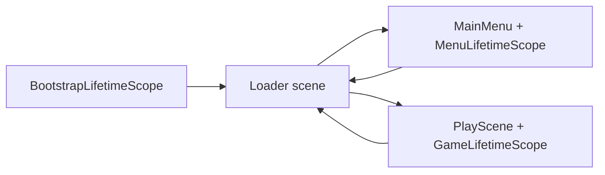

# Architecture

One-page overview of the PocketMatch client.

## Scene and boot flow

Build order:

1. `Loader` — cold-start hub, progress UI, optional interstitial gate
2. `MainMenu` — meta / menu presenters
3. `PlayScene` — Match-3 gameplay

Typical transitions:

```text
Cold start
  -> Loader (bootstrap services live here)
  -> MainMenu
  -> Loader (optional interstitial before gameplay)
  -> PlayScene
  -> Loader (win path may show interstitial)
  -> PlayScene or MainMenu
```

In the Unity Editor, `EditorBootstrapper` forces Play Mode to start from `Loader` when the open scene is in the build list.



## DI scopes

| Scope | Lifetime | Responsibilities |
|-------|----------|------------------|
| `BootstrapLifetimeScope` | `DontDestroyOnLoad` singleton | Save, economy, analytics, input, audio, ads, localization |
| `MenuLifetimeScope` | Main menu scene | Menu presenters and views |
| `GameLifetimeScope` | Play scene | Session, level earnings, continue, HUD, grid presenters, board wiring |

Services register through VContainer with constructor / method injection.

## Core services

| Service | Responsibility |
|---------|----------------|
| `SaveService` | Encrypted local save (`save.dat`), progression updates, cloud sync through `ICloudSaveProvider` |
| `EconomyService` | Wallet ledger (`PlayerData.coins`), spend/add, save trigger, balance events |
| `LevelEarningsService` | Per-attempt earnings from gameplay (power tiles, unused-move bonus) |
| `LevelContinueService` | Lose-menu continue gate (once per attempt); applies `ShopOffer` rewards |
| `AnalyticsService` | Maps level and economy events to analytics names; queues and delivers them through `IAnalyticsTransport` |
| `AdsService` | `IAdsService` facade over per-format controllers (banner, interstitial, rewarded), SDK init, and a shared retry policy |
| `AudioService` | Cue-based SFX |
| `EffectService` | VFX pooling / playback |
| `InputService` | Shared input ticks |

Optional SDK and save configuration load from gitignored files under `Assets/StreamingAssets/`.

## Board command cycle

Board mutations run through an async command queue:

- `ICommand` / `CommandInvoker` serialize `ExecuteAsync` work
- Gameplay commands include `SwapCommand`, `DestroyCommand`, `GravityCommand`, `CreatePowerTileCommand`, and `StaggeredDestroyCommand`
- `GridController` orchestrates match cycles, then asks `BoardStateEvaluator` for potential moves
- Power tiles caught in a match queue their own destroy commands, which drain before gravity; a double tap or a power swap locks input, costs one move, and resolves the board once
- Zero potential moves triggers shuffle-until-playable via `GridHelperMethods`

## Ads

| Format | Placement | Behavior |
|--------|-----------|----------|
| Banner | Bottom center | Shown on the main menu when loaded; hidden when a level starts |
| Interstitial | Loader transitions | Tried when leaving the win screen, to the next level or the main menu |
| Rewarded | Lose menu continue | Opt-in; extra moves granted only on a confirmed reward. One continue (coins or ad) per attempt; repeat taps while the ad is up are ignored |

Editor builds and debug builds with simulation switched on simulate banner, interstitial, and rewarded outcomes without the network; the rewarded outcome is selectable. Debug builds also expose an ads report that checks the local configuration and lists per-format load state and the last load error. Device builds initialize LevelPlay when local ad configuration is present. The rewarded unit is optional there: without it the ad continue stays unavailable on device. Ad failure paths (including rewarded no-fill) log `ad_skipped` and continue scene flow, and the Loader waits for ads with timeouts so they never block loading; a failed rewarded show turns the ad option off for that lose screen.

## Save

- Local save is encrypted JSON at `Application.persistentDataPath/save.dat`
- `PlayerData.meta.saveVersion` is the schema version; `SaveService` runs `DataMigrator` when on-disk schema lags `SaveService.CurrentSaveVersion`
- **Cloud sync:** `SaveService` talks to `ICloudSaveProvider`. `NullCloudSaveProvider` is registered, so saves stay on the device and the footer shows only the version
- **Conflict policy (no merge):** with an enabled provider, a cloud document found on init replaces in-memory and local disk data. Upload and init failures leave the local save intact and set `ISaveService.CloudSyncStatus`
- `PlayerData.coins` is the wallet field; all mutations go through `EconomyService`

## Economy

```text
LevelEarningsService (game-scoped, ephemeral)
  -> computes attempt earnings on win
  -> LevelEvents.OnLevelCompleted
EconomyService (bootstrap singleton)
  -> AddCoins on win / TrySpendCoins on purchases
  -> SaveService.Save()
LevelContinueService (game-scoped)
  -> TryContinueWithCoins via ShopOffer asset
  -> LevelManager.GrantExtraMoves (resume without scene reload)
```

| Data | Location |
|------|----------|
| Wallet | `PlayerData.coins` |
| Continue offer | `Assets/_Project/Scriptables/Resources/ContinueExtraMoves.asset` (loaded via `Resources.Load("ContinueExtraMoves")`) |
| Attempt earnings | `LevelEarningsService` only; not persisted until win |

Win UI shows coins earned this level; HUD and lose panel show wallet balance (`x N`). Objectives and moves stay visible on fail so the player can judge whether continue is worthwhile.

Continue is once per attempt via coins.

## Live-service hooks

| Hook | Entry point |
|------|-------------|
| Level start / complete / fail | `LevelEvents` → `AnalyticsService` |
| Coins earned | `LevelEvents.OnLevelCompleted` → `EconomyService.AddCoins`; `AnalyticsService` logs `coins_earned` from the same event |
| Coins spent | `EconomyService.TrySpendCoins` → `OnCoinsSpent` → `coins_spent` |
| Lose continue | `LosePresenter` → `LevelContinueService` → `EconomyService` or `AdsService.ShowRewardedAdAsync` → `LevelManager.GrantExtraMoves` |
| Interstitial gate | `WinPresenter` → `Loader.ShowInterstitialThenContinue` |
| Banner | `MainMenuPresenter` shows; `LevelSelectPresenter` and interstitial show hide |

## Localization

- Package: `com.unity.localization` with locales `en` (source) and `es`
- Player-facing copy lives in the `UI` String Table Collection (`ui.*` keys); placeholders use indexed `{0}`
- Runtime lookup goes through `ILocalizationService` / `LocalizationService` (bootstrap singleton)
- Static TMP chrome uses `LocalizedTmpLabel`; loader progress text and dynamic HUD/dialog copy also resolve through the same service
- Empty or missing `es` cells fall back to `en` (no player-facing MISSING text)
- Spanish Locale asset carries **Fallback Locale** metadata pointing at English; String Database **Use Fallback** is enabled
- Startup locale: device/system via Unity selectors, with `en` fallback
- Editor Play Mode: Game View locale dropdown (Unity Localization, on by default)
- Localizer interchange uses the Unity String Table CSV format only, exported to and imported from `Assets/Localization/Export/{TableCollectionName}.csv` by Editor tooling. Catalog JSON stays out of this repo.

## Related docs

- [Analytics events](analytics-events.md)
- [Third-party attribution](third-party.md)
